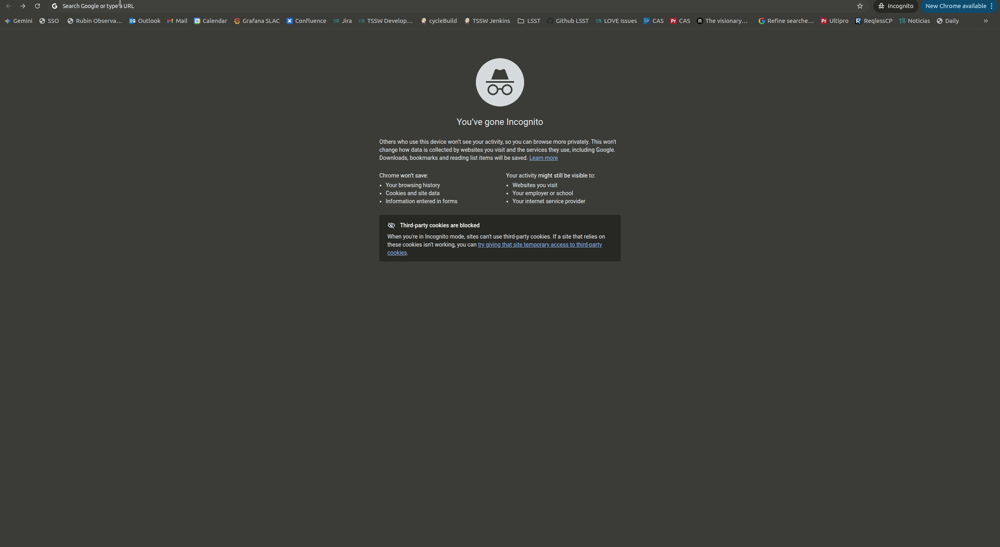

# Testing

The frontend has three test suites:

| Suite | Runner | Location | Command | Runs in CI |
|---|---|---|---|---|
| Unit tests | Vitest | `tests/*.test.js` | `npm test` | Yes |
| Mocked end-to-end tests | Playwright | `tests/e2e/mocked/`, `tests/e2e/snd/` | `npm run test:e2e` | Yes |
| Stress tests | Playwright | `tests/e2e/stress-tests-*.spec.js` | `npm run test:e2e:stress` | No |

Jenkins runs the unit tests and the mocked end-to-end tests on every pull
request, after the pre-commit hooks.

---

## 1. Unit tests

The unit tests cover the utilities in `src/utils/` and the route search
parameter schema. They run in jsdom, with `vitest-canvas-mock` standing in for
the canvas API (set up in `vitest.setup.js`).

```shell
npm test                                # run once
npx vitest                              # watch mode
npx vitest run tests/timeUtils.test.js  # run a specific test
```

---

## 2. Mocked end-to-end tests

These drive the real app in Chromium with every backend request mocked, so
they need no backend, credentials or network access. The full suite of
these tests takes a long time to run, as they are quite comprehensive.

### Setup

Install the browser once:

```shell
npx playwright install chromium
```

On Linux, `npx playwright install-deps chromium` installs the system libraries
the browser needs, if they are missing.

### Running

```shell
npm run test:e2e                                    # everything
npm run test:e2e -- --project=snd                   # one project
npm run test:e2e -- tests/e2e/mocked/plots          # one directory
npm run test:e2e -- --grep "time range"             # tests matching a name
npm run test:e2e -- --ui                            # interactive UI mode
npx playwright show-report                          # last run's HTML report
```

### Projects

The configuration, `playwright.mocked.config.js`, defines two projects, each
against its own Vite dev server:

| Project | Specs | App | Server |
|---|---|---|---|
| `mocked` | `tests/e2e/mocked/` | The internal Nightly Digest, under `/nightlydigest/` | `localhost:5175` |
| `snd` | `tests/e2e/snd/` | The [Scientific Nightly Digest](getting-started.md#running-the-scientific-nightly-digest), at `/` | `localhost:5176` |

`VITE_SCIENTIFIC_NIGHTLY_DIGEST` is resolved when the app is built, so the SND
needs its own separate server. The `snd` project only tests what differs in
the SND. Behaviour shared by both builds is tested once, in the main `mocked`
project.

The servers use ports 5175 and 5176 rather than Vite's default 5173 so that the
suite never attempts to connect to the Docker Compose `frontend` container if
it is running on the same machine. Set `E2E_PORT` or `E2E_SND_PORT` to use other ports.

### Mocking the backend

`setupApiMocks(page, overrides)` in `tests/e2e/helpers/mock-api.js` intercepts
every backend endpoint the app calls. Call it before navigating:

```js
test.beforeEach(async ({ page }) => {
  await setupApiMocks(page);
});
```

By default each endpoint returns a fixture from `tests/e2e/mocks/fixtures/`.
The fixtures describe the night of `dayobs=20260101`; `tests/e2e/helpers/constants.js`
has the page URLs and time-range boundaries for that night.

To change a response, pass an override keyed by endpoint name. The value is
either the response body or the name of a fixture file:

```js
await setupApiMocks(page, { "data-log": { data_log: [] } });
await setupApiMocks(page, { "data-log": "datalog-null-airmass" });
```

`tests/e2e/helpers/mock-generators.js` builds response bodies in code, for
example `generateDataLogMock(count, { overrides, postProcess })` for data-log
records. To save generated data as a new fixture, use `writeFixture` from
`tests/e2e/mocks/scripts.js`.

`recordRequests(page, endpoint)` records the requests made to an endpoint, to
assert whether a page calls it at all and that the correct query parameters
were used.

### Layout

- `tests/e2e/mocked/<page>/` holds one directory per page, and `shared/` holds
  the header, sidebar, routing and other behaviour common to every page.
- `tests/e2e/mocked/components/datatable/` tests the shared `DataTable` once per
  page that uses it. Each page's columns, mocks and expected results are
  described in `DATATABLE_PAGES` in `tests/e2e/helpers/datatable-pages.js`.
- `tests/e2e/helpers/` has per-page helpers for waiting on loads and locating
  elements.

---

## 3. Stress tests

The stress tests load real deployments repeatedly to check pages finish loading
under load. Each file targets one deployment:

| File | Target |
|---|---|
| `stress-tests-last-night-usdfdev.spec.js` | https://usdf-rsp-dev.slac.stanford.edu/nightlydigest |
| `stress-tests-last-5-nights-usdfdev.spec.js` | https://usdf-rsp-dev.slac.stanford.edu/nightlydigest |
| `stress-tests-last-night-base.spec.js` | https://base-lsp.lsst.codes/nightlydigest |
| `stress-tests-last-5-nights-base.spec.js` | https://base-lsp.lsst.codes/nightlydigest |

They run in Chromium and Firefox, so install both with `npx playwright install`.

The deployments need authentication. Log in to the target deployment in a
browser, copy the value of the `gafaelfawr` cookie, and export it:

```shell
export GAFAELFAWR_COOKIE='<cookie value>'
```



Run one file at a time, against a deployment you have access to:

```shell
npm run test:e2e:stress -- tests/e2e/stress-tests-last-night-base.spec.js
```

Playwright's options control the load, for example running each test five times
across ten workers:

```shell
npm run test:e2e:stress -- tests/e2e/stress-tests-last-night-base.spec.js \
  --grep "Nightly Digest Dashboard page" --repeat-each=5 --workers=10
```
